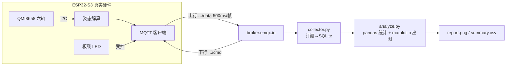

# esp32-attitude-iot-dashboard · ESP32 姿态数据上云 + Python 分析

> **一句话亮点**：把本地屏幕上的姿态数据，升级成 **MQTT 上云 → 云端采集入库 → pandas 分析出图** 的完整物联网链路，并加入 **云端下发命令控制 LED** 的下行通道，是一个端-云-边闭环 + 双向通信的最小可演示系统。

## 架构（mermaid）



## 项目亮点

1. **端-云-边完整闭环**：固件侧采集解算 → MQTT 上行 → Python 侧落库分析，不是"玩具 demo"，而是真实 IoT 数据流。
2. **双向通信**：除上行数据外，还实现云端下发命令控制 LED，演示了发布/订阅双向能力。
3. **零依赖分析端**：`analyze.py` 只用标准库 + pandas/matplotlib，输出自包含 HTML/SVG 报表，clone 即跑。
4. **安全意识**：WiFi 密钥不进仓库（`.gitignore` 忽略模板外文件），公共 Broker 上的数据不含隐私。

## 与作品集其他仓库的关联

- [esp32-qmi8658-attitude-monitor](https://github.com/swdscsc/esp32-qmi8658-attitude-monitor) —— 姿态解算来源
- [stm32-esp8266-huaweicloud-iot](https://github.com/swdscsc/stm32-esp8266-huaweicloud-iot) —— STM32 侧的 MQTT 上云对照实现
- [log-analysis-toolkit](https://github.com/swdscsc/log-analysis-toolkit) —— 同属"日志/数据 → 分析出图"的工程化思路

## 面试可能被追问 & 回答思路

| 追问 | 思路要点 |
| --- | --- |
| MQTT 和 HTTP 上云怎么选？ | MQTT 长连接 + 发布订阅，适合小数据高频上报；HTTP 适合偶发请求 |
| 断网了数据怎么办？ | 本地环形缓冲 + 重连后补传（项目计划项）；演示用公共 Broker 暂不实现 |
| 为什么用 SQLite 不是直接画图？ | 落库后可二次分析、可长期趋势；解耦采集与展示 |
| 实时性够吗？ | 500ms 上报对姿态监测足够；更高频可调发布周期 |

## 项目状态（诚实标注）

- [x] 固件：WIFI / QMI / LED 组件复用自真实项目，新增 MQTT_APP 组件
- [x] Python 端：采集入库 + 统计分析脚本
- [ ] 上机验证：烧录固件 + 真实传感器收发（进行中）
- [ ] 采集 10 分钟数据并产出分析报告

## 快速开始 / 硬件平台 / License

固件端（需 ESP-IDF，详见 `docs/手把手教程.md`）：

```bash
cp components/WIFI/wifi_secrets_example.h components/WIFI/wifi_secrets.h   # 填入 WiFi 账号
idf.py set-target esp32s3
idf.py build flash monitor
```

Python 端：

```bash
cd python && pip install -r requirements.txt
python collector.py      # 开始收数据，Ctrl+C 停止
python analyze.py        # 生成 report.png + summary.csv
```

想不写代码先看效果？用 [MQTTX](https://mqttx.app/) 连 `broker.emqx.io`，订阅 `swdscsc/attitude/data` 即可看到 JSON 数据流。

| 项目 | 参数 |
| --- | --- |
| MCU | ESP32-S3 |
| 传感器 | QMI8658 六轴（I2C：SCL=GPIO41，SDA=GPIO42） |
| 指示灯 | GPIO1 板载 LED（受云端命令控制） |
| 联网 | WiFi Station 模式 |

License：MIT
